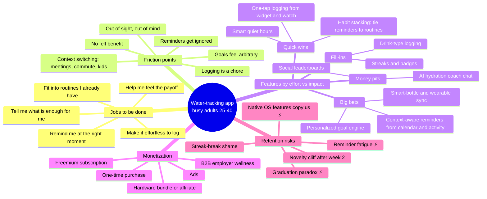

# Discovery Sprint Brainstorm: Mobile Water-Tracking App

> **Who it's for:** Busy adults aged 25–40 who know they should drink more water but forget.
> **What this is:** A brainstorm map to start the discovery sprint. Everything here is a hypothesis to test, not a finding.
> **How to read it:** ⚡ marks a **strategic tension**, a real disagreement the team needs to settle before we commit. The tensions are collected at the end.

---

## 1. Mindmap overview



---

## 2. Core jobs to be done

| # | Job statement ("When ___, I want to ___, so I can ___") | Type | Discovery question |
|---|---|---|---|
| J1 | When I'm deep in work, I want a nudge **at a moment I can act on it**, so I don't get to 4pm having had one coffee. | Functional | When do they forget, and when could they actually drink? |
| J2 | When I drink something, I want to record it **in under 2 seconds without opening an app**, so tracking doesn't become another task. | Functional | How many taps before people give up? |
| J3 | When I set a goal, I want to know **what's enough for my body and my day** (heat, exercise, caffeine), so I trust the number. | Functional / trust | Do users trust "8 glasses"? Would they share body data for a better number? |
| J4 | When I do drink more, I want to **notice a difference** (energy, fewer headaches, skin, focus), so I stay motivated. | Emotional | What payoff do people actually feel, and how soon? |
| J5 | When I'm trying to be healthier, I want to **feel in control of at least one easy habit**, so I feel like I'm taking care of myself. | Emotional / identity | Is water a "gateway habit" that leads into other wellness goals? |
| J6 | When my routine changes (travel, weekends, a sick kid), I want the app to **adapt instead of nagging me**. | Functional | How do routines differ between weekdays and weekends? |

**Main hypothesis:** The job users are paying the app to do is **J1 (remembering at the right moment)** and **J2 (logging without effort)**. J3 and J4 drive whether they keep using it. If discovery shows the main job is actually J4 or J5 (feeling healthier), our positioning changes from a utility to a wellness habit coach.

---

## 3. Friction points in current behavior

| Friction | What it looks like | Root cause | Today's workaround |
|---|---|---|---|
| **Out of sight, out of mind** | Their bottle sits in the car or the kitchen | No cue in the environment | Bottle on the desk, rubber bands on the bottle |
| **Logging is a chore** | They download a tracker and stop logging by day 5 | Opening the app costs more effort than the benefit | They stop logging and guess |
| **Reminders get ignored** | A buzz arrives mid-meeting; they swipe it away and forget for good | Reminders go off on a timer, not when they can act | Phone alarms, then turning them off |
| **Goals feel arbitrary** | "Why 2.7L? I'm not an athlete." | Generic formulas, no explanation | They ignore the goal |
| **No felt benefit** | "I drank more for a week and felt the same." | The payoff is slow and hard to see | Motivation fades |
| **Context switching** | Commutes, meetings, school runs, travel | Days are fragmented and unpredictable | None that holds up |
| **Swaps with other drinks** | They drink coffee, soda, or sparkling water instead | Unclear what "counts" | Guilt, or not counting it |
| **Tracking fatigue** | They already track steps, sleep, food, and cycle | Too many apps and dashboards | They give up on "minor" trackers first |

**Note:** Of these, the first three come from the product and the moment, and we can fix them. "No felt benefit" is partly about human biology, and we can only reframe it, not fully solve it. Be careful about over-promising here (see ⚡T4).

---

## 4. Feature ideas, ranked by effort vs. impact

Scoring: **Impact** = expected effect on 30-day retention and daily logging (1–5). **Effort** = rough engineering and design cost (1–5). **Priority** = Impact ÷ Effort.

| Rank | Feature | Job / friction it addresses | Impact | Effort | Priority | Quadrant |
|---|---|---|---|---|---|---|
| 1 | **One-tap logging** from home-screen widget, lock screen, watch complication, and actionable notifications | J2 / logging is a chore | 5 | 2 | 2.5 | 🟢 Quick win |
| 2 | **Smart quiet hours**: no reminders during sleep or Focus/DND modes; catch-up nudge afterwards | J1, J6 / reminders ignored | 4 | 2 | 2.0 | 🟢 Quick win |
| 3 | **Habit stacking**: attach reminders to existing anchors ("after my first coffee", "when I get to the office" via geofence) | J1 / out of sight | 4 | 2 | 2.0 | 🟢 Quick win |
| 4 | **Explained, adjustable goal**: a simple formula plus a "why this number" screen, editable by the user | J3 / arbitrary goals | 3 | 1 | 3.0 | 🟢 Quick win |
| 5 | **Context-aware reminders** using calendar gaps, step/workout data, and weather | J1, J6 | 5 | 4 | 1.25 | 🔵 Big bet |
| 6 | **Personalized goal engine** (body size, activity, climate, caffeine) via HealthKit/Health Connect | J3 | 3 | 3 | 1.0 | 🔵 Big bet ⚡T2 |
| 7 | **Payoff mirror**: optional 1-tap daily check-in (energy, headache) correlated with intake over weeks | J4 / no felt benefit | 4 | 3 | 1.33 | 🔵 Big bet ⚡T4 |
| 8 | **Smart-bottle and wearable sync** (passive logging) | J2 | 4 | 5 | 0.8 | 🔵 Big bet ⚡T3 |
| 9 | **Forgiving streaks** (streak freezes, "4 of 7 days" weekly goals instead of fragile daily streaks) | Retention | 3 | 1 | 3.0 | 🟢 Quick win |
| 10 | **Drink-type logging** (coffee, tea, sparkling) with hydration factors | Swaps with other drinks | 2 | 1 | 2.0 | ⚪ Fill-in |
| 11 | **Badges and achievements** | Retention | 2 | 2 | 1.0 | ⚪ Fill-in |
| 12 | **Social and team challenges** | J5, retention | 2–4* | 4 | ~0.75 | 🔴 Money pit for B2C, bet for B2B |
| 13 | **AI hydration coach chat** | J3, J4 | 2 | 4 | 0.5 | 🔴 Money pit ⚡T4 |

\* Social features score low for single consumers (25–40-year-olds rarely want to compete on water) but high in an employer wellness context. Their value depends on the monetization decision (⚡T5).

**Suggested MVP slice to test:** #1 + #2 + #3 + #4 + #9. These are cheap and address the top two jobs directly. Use the sprint to find out whether #5 (context-aware reminders) is worth building as our real point of difference.

```
 Impact
   5 |  [1 One-tap]                    [5 Context-aware]
   4 |  [2 Quiet hrs] [3 Stacking]  [7 Payoff mirror]   [8 Bottle sync]
   3 |  [4 Goal] [9 Streaks]        [6 Goal engine]
   2 |  [10 Drink types] [11 Badges]       [12 Social] [13 AI coach]
   1 +---------------------------------------------------------- Effort
        1           2           3           4           5
```

---

## 5. Monetization paths with tradeoffs

| Path | How it works | ✅ Pros | ❌ Cons | Fit with this audience |
|---|---|---|---|---|
| **Freemium subscription** (~$2–5/mo) | Core tracking free; paid tier gets context-aware reminders, insights, integrations | Recurring revenue; works with the App Store model | People expect water tracking to be free; many competitors are free; subscription fatigue | Medium. Users have money, but the bar for "worth a subscription" is high |
| **One-time purchase / lifetime unlock** | Pay once, e.g. $9.99 | Low friction; honest; fits a "graduation" product (⚡T1) | No recurring revenue to fund context-aware or AI features; growth spikes only at launch | Medium-high. Respects users, but limits the business |
| **Hardware bundle / affiliate** | Smart-bottle partners, bottle affiliate links, or our own bottle | Physical cue solves "out of sight"; higher order value | Heavy on inventory or dependent on partners; hardware churn; low margins | Low-medium. Busy adults lose bottles |
| **B2B2C employer / insurer wellness** | Sold per employee per month to HR or wellness platforms, with team challenges | Large contracts; CAC is shifted to the buyer; social features make sense | Long sales cycles; buyer ≠ user; privacy and trust concerns; a different product | High reach. Risks the trust of the consumer core (⚡T5) |
| **Ads / sponsored content** | Display ads, beverage brand sponsorships | Free for users | Hurts a calm, trusted wellness feel; brand conflicts (sugary drinks); thin revenue at small scale | Low. Not recommended |
| **Data licensing** | Aggregated, anonymized hydration data | — | Serious trust and regulatory risk in health tech | ❌ Rule out explicitly |

**Recommendation to test, not decide:** Start with freemium focused on one paid "smart" feature (context-aware reminders + insights), and run a pricing experiment against a lifetime-unlock option. Treat B2B as a separate discovery track, not as the default.

---

## 6. Retention risks and mitigations

| Risk | Why it happens | Leading signal | Mitigation |
|---|---|---|---|
| **Reminder fatigue** ⚡T1 | Too many or badly timed pushes → notifications muted → app forgotten | Push opt-out rate, notifications dismissed without logging | Adaptive frequency (fewer pushes when the user is on track); context-aware timing; reminders sent fewer times when ignored; a "pause today" button |
| **Novelty cliff (days 7–14)** | The initial motivation fades; logging feels like a chore | Drop in logs per active day after week 1 | Effortless logging (widget, watch); weekly reflection at day 7; give the first payoff in the first week |
| **Streak-break shame** | A missed day breaks a 20-day streak → "what's the point" → churn | Churn right after a broken streak | Forgiving streaks, streak freezes, weekly goals; supportive messages instead of guilt |
| **No felt benefit** ⚡T4 | Benefits are subtle and slow | Low check-in engagement; "is this working?" feedback | Payoff mirror with the user's own data; honest framing ("most people notice energy before anything else") |
| **Graduation paradox** ⚡T1 | Success means the habit sticks, so users stop needing the app | Long-tenured users logging less but still hydrated | Define success as habits, not opens; "maintenance mode" with weekly check-ins; extend to adjacent habits |
| **Routine disruption** | Travel, weekends, illness break the pattern | Weekend/travel logging gaps | Weekend profiles; travel mode; skip-a-day without penalty |
| **Platform copies us** ⚡T3 | Apple/Google/Fitbit add native water reminders | — (external) | Lean into what platforms won't do well: context-aware timing, personalization, cross-platform; integrate with them, don't compete |
| **Tracker overload** | Users cut down their many health apps | Uninstalls alongside other wellness apps | Sync into Health apps so we are where users already look, not another silo |

---

## 7. ⚡ Strategic tensions to debate

These are the areas where reasonable people on the team will disagree. Each needs a decision, an owner, or a sprint experiment.

### ⚡T1: Nag vs. respect (and the graduation paradox)
Reminders are the core value (J1) **and** the top reason people churn. Also, if we succeed and the habit sticks, users need us less.
- **Side A:** Optimize for daily engagement. More reminders, streaks, opens → better metrics and subscription value.
- **Side B:** Optimize for habit formation. Fewer, smarter reminders; accept lower opens; maybe a "graduate" moment.
- **Why it matters:** This decides our North Star metric (daily logs vs. % of days hydrated vs. 90-day habit retention) and our monetization model (subscription vs. lifetime).
- **Sprint test:** Compare a fixed-schedule reminder cohort with an adaptive/fewer-reminders cohort; measure logging *and* push opt-out at day 14.

### ⚡T2: Personalization vs. privacy and friction
Better goals (J3) require body, activity, and location data. Health data raises trust risks, onboarding friction, and compliance obligations.
- **Question:** Does a personalized goal improve retention enough to justify asking for HealthKit/location permissions at onboarding?
- **Default stance:** Collect data progressively. Start with a simple explained goal; ask for permissions only when a feature clearly benefits from them. Keep data on the device where possible.

### ⚡T3: Software-only vs. hardware/platform play
Passive logging (smart bottles, wearables) solves J2 best but brings hardware economics and dependence on partners. Meanwhile, OS makers could add basic water tracking natively.
- **Question:** Is our moat **context-aware intelligence** (software) or **passive capture** (hardware)? We probably can't afford both early on.
- **Note:** If our main differentiator is something a platform can copy in one release, we have a positioning problem, not a feature gap.

### ⚡T4: Wellness claims vs. health-tech credibility
The "felt benefit" story (energy, focus, headaches) drives motivation, but health claims bring regulatory and credibility risk. An AI coach that gives hydration advice raises the stakes (e.g., users with kidney or heart conditions, pregnancy, or medications that limit fluids).
- **Question:** How far do we go with outcome claims and personalized advice?
- **Required:** Have legal/clinical review messaging and any goal-setting logic. Show safety disclaimers and add a "check with your doctor" path for medical conditions. Do not market it as a medical device.

### ⚡T5: Consumer trust vs. B2B revenue
Employer/insurer wellness deals offer revenue and distribution, but "my employer can see my water intake" can damage trust with consumers. It also pushes the roadmap toward team challenges and admin dashboards instead of the core consumer jobs.
- **Question:** Are we a consumer brand that could later offer a B2B channel, or a B2B wellness product from the start?
- **Guardrail if we explore B2B:** Employers see only aggregated, anonymized data with minimum group sizes; individual data is never shared without explicit opt-in.

### ⚡T6 (smaller): Utility vs. lifestyle brand
Is this a quiet tool you use for 2 seconds a day, or a wellness brand people want to spend time in? This affects design, content investment, and pricing.

---

## 8. Discovery sprint plan (suggested next steps)

1. **Interviews (8–12 people, 25–40, self-described "forgetful" drinkers):** map a typical day and find the moments when they forget. Test whether J1/J2 or J4/J5 is the main job.
2. **Diary study (7 days):** log drinks with a paper/WhatsApp proxy to measure actual friction and see where reminders could work.
3. **Fake-door / pricing test:** landing page comparing "smart reminders" subscription vs. lifetime unlock (⚡T1, monetization).
4. **Competitive teardown:** existing water apps, native Health/Fitbit features, and smart bottles; look at reviews for churn reasons (⚡T3).
5. **Decision meeting:** settle ⚡T1 and ⚡T5 before writing the PRD, because they determine the North Star metric and the roadmap.

**Candidate North Star metrics (decide in ⚡T1):** % of active users who meet their personal goal on ≥4 days per week, measured at day 30.

---

_All figures (scores, prices) are illustrative assumptions for the brainstorm and should be validated in discovery. Have a person review this before it is used in decision-making._
